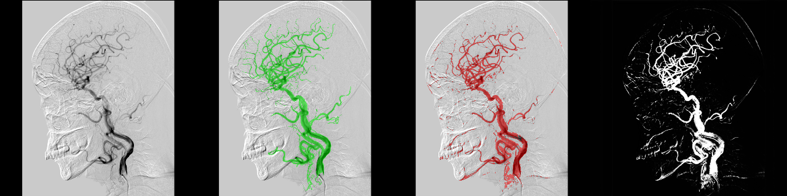
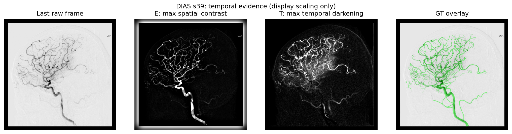
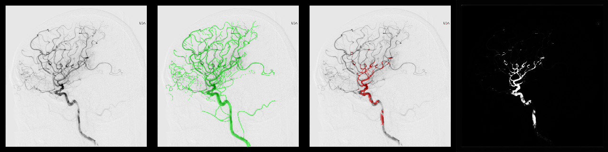
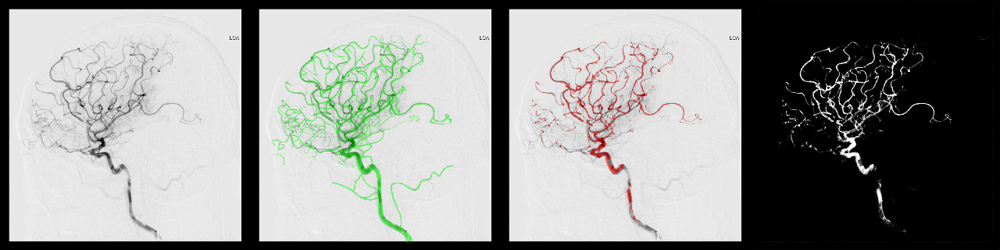
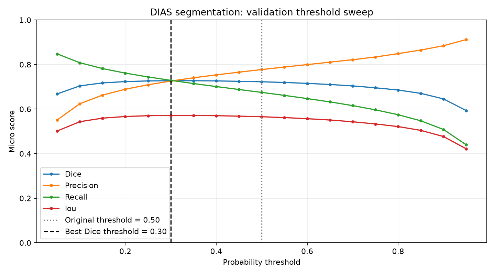

# Cerebral Vessel Segmentation from DSA Sequences

A small investigation of cerebral vessel segmentation in digital subtraction angiography (DSA), using the [DIAS dataset](https://github.com/lseventeen/DIAS). I started by exploring how contrast propagates through the sequence, then built a lightweight segmentation model and tested what information actually helped it.



*Seven-channel U-Net on validation sequence s34. From left: last frame, ground truth (green), prediction at threshold 0.5 (red), and probability map.*

## Understanding the images

DIAS provides a vessel annotation for each sequence, but the full vascular tree isn't necessarily visible in any single frame. I used an interactive viewer to examine contrast progression and compare vessel-like responses with the annotations. The labeled subset used here has **30 training and 10 validation sequences**.

I first tried local dark-contrast filtering, accumulated responses, temporal differencing, and connected weak-response growth. These methods recovered much of the vascular structure but were sensitive to background anatomy and weaker branches. They also pointed toward something useful: **evidence from different moments in the acquisition should be preserved**.

## A lightweight baseline

I implemented a depthwise-separable **U-Net (~449K parameters)** predicting one sequence-level vessel mask from the **last five DSA frames**. Training uses PyTorch, AdamW, OneCycleLR, synchronized crop/zoom augmentation, mixed precision, and BCE + soft Dice.

I then tested focal loss, centerline supervision, and a lightweight hybrid clDice approximation. They changed the precision/recall tradeoff, but none consistently improved the overall result. Rather than increasing model capacity or continuing to tune losses, I returned to the original image-processing observations.

## Bringing temporal evidence into the network

I appended two engineered channels to the five raw frames:

- **E, accumulated spatial evidence:** Maximum positive local dark-contrast response over the whole sequence, relative to a Gaussian-estimated background.
- **T, accumulated temporal change:** Maximum darkening relative to the first frame, after global brightness compensation and modest spatial smoothing.



*The E and T panels are contrast-stretched **for display only**. The model receives the original response values scaled by 255.*

Both features use the **complete acquisition**, whereas the raw input contains only its last five frames. This adds temporal coverage as well as engineered representations, so the experiment does not isolate those two effects.

## Results

| Input / objective | Best validation micro-Dice |
|---|---:|
| Five raw frames, BCE + Dice | 0.683 |
| Five raw frames, alternative losses | ~0.672–0.684 |
| **Five frames + E + T, BCE + Dice** | **0.728** |
| Five frames + E + T, hybrid clDice | 0.728 |

*Each score uses one global threshold selected on the same ten-sequence validation split. These are exploratory validation results, **not held-out test results**. Exact values and thresholds are in [`results/experiments.csv`](results/experiments.csv).*

Sequence **s39** was especially informative. The seven-channel model recovers substantially more of the branching network than the five-frame baseline, although segments of some larger vessels still disappear. The two previews below both use threshold **0.5**, for a like-for-like visual comparison.

**Five raw frames**



**Five frames + E + T**



<details><summary>Seven-channel validation threshold sweep</summary>



</details>

## Running it

Install a [PyTorch build](https://pytorch.org/get-started/locally/) appropriate for your hardware, then `pip install -r requirements.txt`. The DIAS data is **not included**; download it from the source linked above and provide the directory containing `training/images`, `training/labels`, `validation/images`, and `validation/labels`.

```bash
python scripts/train.py --data-root /path/to/DIAS \
    --feature-mode raw_et --cldice-weight 0 --batch-size 2

python scripts/evaluate.py --data-root /path/to/DIAS \
    --checkpoint checkpoints/et-bce/best.pt \
    --feature-mode raw_et --output-dir output/et-bce/evaluation
```

Use `--feature-mode raw` for the five-channel baseline. `scripts/dias_quicklook.py` is the interactive exploration tool (set its `DATA_DIR` near the top); `scripts/make_temporal_figure.py` recreates the E/T illustration. The code lives under `src/`, and the training/evaluation entry points under `scripts/`.

## Takeaway

Improving the **input representation** helped more than changing the loss. The classical experiments weren't the final segmentation solution, but they revealed useful signals to give the model. Individual failures still matter, and ten validation sequences are far too few to claim clinical generalization. This is an exploratory engineering study, not a clinically validated system.
